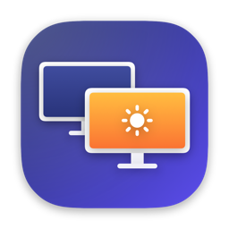
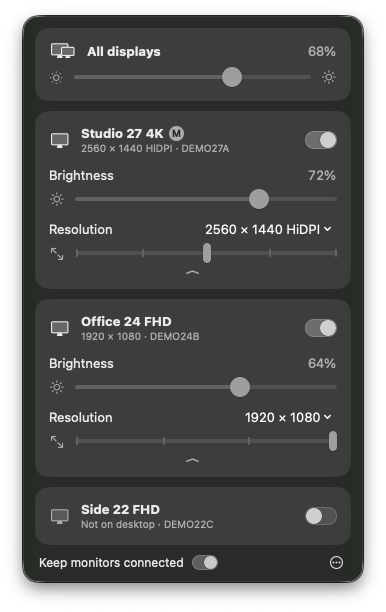

<p align="center">
  
</p>

<h1 align="center">DisplayLatch</h1>

<p align="center">
  <b>Keep external monitors connected on your Mac.</b><br>
  A free, open-source macOS menu-bar app. If an external monitor stays black or undetected after sleep, DisplayLatch brings it back. It also controls external monitor brightness over DDC and lets you disconnect a display without unplugging it.<br>
  A lightweight, free alternative to BetterDisplay for these everyday tasks.
</p>

<p align="center">
  <a href="https://github.com/Hitesh-Sisara/DisplayLatch/releases/latest"></a>
  <a href="LICENSE"></a>
  
  
  <a href="https://github.com/Hitesh-Sisara/DisplayLatch/actions/workflows/ci.yml"></a>
</p>

<p align="center">
  
</p>

## Why DisplayLatch?

Many Macs with two monitors run into this: after **sleep, wake, a restart or a replug, one external monitor stays black**. Or it disappears from the desktop even though the Mac still sees it. System Information may still list the monitor, and reseating the cable often doesn't help.

One cause is that macOS WindowServer marks the monitor as an *independent output* and keeps it off the desktop. The setting is stored, so it comes back on every reboot. DisplayLatch watches for this and **puts the monitor back on the desktop automatically, in the same position it had before**. You don't need to unplug anything, restart, or delete preference files.

On top of that it covers the everyday display controls in one small native menu-bar app.

## Features

- **Keep monitors connected.** It automatically reconnects external monitors that macOS leaves dark or off the desktop after sleep, wake, a restart or a replug, and restores your display arrangement.
- **Disconnect a display without unplugging it.** It takes a monitor off the desktop with one switch, and switching it back on returns it to its old position. It's free (in BetterDisplay this is a paid Pro feature).
- **External monitor brightness (DDC/CI).** It changes the monitor's real backlight, not a dimming overlay, on Apple silicon Macs.
- **One slider for every display.** Dim or brighten all your monitors together, or tune each one separately.
- **Built-in display brightness** for the MacBook screen.
- **Resolution switcher.** A slider and a menu with every mode macOS offers for each display, including HiDPI modes.
- **Command-line tool.** Script brightness, resolution, connecting and fixing displays from Terminal, Shortcuts or cron.
- **Native and tiny.** Swift and SwiftUI, about 1.5 MB, no Electron, no background services, no account, no telemetry.
- **Free and open source** under the MIT license.

## Download and install

1. Download **`DisplayLatch-<version>.dmg`** from the [latest release](https://github.com/Hitesh-Sisara/DisplayLatch/releases/latest).
2. Open the DMG and drag **DisplayLatch** into **Applications**.
3. Open DisplayLatch. A display icon appears in the menu bar.

> **First launch.** Releases are not notarized by Apple yet, so macOS asks before opening the app. Go to **System Settings › Privacy & Security** and click **Open Anyway** next to DisplayLatch. Or run this once in Terminal:
> ```bash
> xattr -dr com.apple.quarantine /Applications/DisplayLatch.app
> ```

DisplayLatch adds itself to **Login Items** on first launch, so it starts when you log in and can fix monitors right after a reboot. You can turn this off in the app's menu or in System Settings › General › Login Items.

**Requirements:** a Mac with Apple silicon (M1, M2, M3, M4 or later), macOS 14 Sonoma or later.

### Build from source

```bash
git clone https://github.com/Hitesh-Sisara/DisplayLatch.git
cd DisplayLatch
./scripts/install.sh        # builds, installs to /Applications, links the CLI
```

You need Xcode 16 or later (Swift 6). Run `swift test` to run the unit tests.

## How "Keep monitors connected" works

DisplayLatch compares two views of your displays:

1. **Hardware.** For each display port, it reads what the display driver knows about the attached monitor (EDID, serial number) from the IOKit registry.
2. **WindowServer.** It checks which displays are actually online on the desktop (CoreGraphics).

A monitor that is attached in hardware but missing from the desktop is brought back. DisplayLatch clears WindowServer's independent-output flag and re-enables the display. Then it moves the display back to its saved position. The check runs after every display change, after wake, and every 20 seconds as a safety net. Any monitor you switch off in DisplayLatch stays off. It never wakes the built-in screen while the lid is closed.

Everything is logged to `~/Library/Logs/DisplayLatch.log`. Open it from the menu with **Open Log**.

## Command line

The app binary is also a CLI. `scripts/install.sh` links it as `displaylatch`.

| Command | What it does |
|---|---|
| `displaylatch list` | List displays with ID, state, name, serial and resolution |
| `displaylatch fix` | Bring back every attached monitor that is off the desktop |
| `displaylatch connect <display>` | Put a display on the desktop |
| `displaylatch disconnect <display>` | Take a display off the desktop without unplugging it |
| `displaylatch brightness <display\|all> [0-100]` | Read or set hardware brightness |
| `displaylatch resolution <display> [1920x1080@2x]` | List modes or switch resolution |
| `displaylatch move <display> X Y` | Place a display in the arrangement (the main display is at 0,0) |

`<display>` can be the display ID, the serial number or the name. Example: dim every monitor to 40% at night:

```bash
displaylatch brightness all 40
```

## DisplayLatch vs BetterDisplay, MonitorControl and Crisp

|  | DisplayLatch | BetterDisplay | MonitorControl | Crisp |
|---|---|---|---|---|
| Price | Free | Free, plus a paid Pro | Free | Free |
| Open source | Yes (MIT) | No | Yes (MIT) | Yes (MIT) |
| Auto-reconnect monitors left dark after sleep | **Yes** | Not advertised | No | Not advertised |
| Disconnect a display without unplugging | Yes | Pro only | No | Yes |
| External monitor brightness (DDC) | Yes | Yes | Yes | Yes |
| Command-line tool | Yes | Yes | Not documented | Yes |
| HiDPI scaling, virtual screens, PIP, XDR | No | Yes | No | Not documented |

This table is based on each project's own website and README as of November 2026. Corrections are welcome.

**Which one should you use?** If you need HiDPI on 1080p or 1440p monitors, virtual screens, picture-in-picture or XDR brightness, [BetterDisplay](https://betterdisplay.pro/) is the most complete tool. [MonitorControl](https://github.com/MonitorControl/MonitorControl) is great for brightness and volume keys. DisplayLatch is for keeping your monitors connected and handling the everyday controls with a small, free, open-source app.

## FAQ

### Why does my external monitor stay black after sleep on Mac?
Often the Mac still detects the monitor, but macOS WindowServer has taken it off the desktop. For example, it may have stored it as an "independent output" or left it disabled after wake. The monitor gets power but receives no picture. Replugging may not help, because the setting is saved and comes back after a restart. DisplayLatch detects this and puts the monitor back on the desktop automatically. You can also run `displaylatch fix` once.

### Why is my second monitor not detected on my MacBook?
First check the hardware. If **System Information › Graphics/Displays** doesn't list the monitor, the problem is physical: the cable, the adapter, the monitor's input or its power. If the monitor *is* listed, or `displaylatch list` shows it as `OFFLINE`, macOS is keeping it off the desktop and DisplayLatch can bring it back.

### How do I disconnect a display on Mac without unplugging it?
Click the DisplayLatch menu-bar icon and turn off the switch next to the monitor, or run `displaylatch disconnect <display>`. The monitor leaves the desktop and your windows move to the other screens. Turn the switch back on to restore it in the same position.

### How do I control external monitor brightness on a Mac?
Most external monitors support DDC/CI, a standard way to control the monitor's own settings over the video cable. DisplayLatch uses DDC to change the real backlight brightness on Apple silicon Macs, per monitor or for all displays at once. If your monitor's menu has DDC/CI turned off, turn it on.

### Is there a free alternative to BetterDisplay?
Yes. DisplayLatch is free and open source. It covers keeping monitors connected, disconnecting displays, DDC brightness, resolution and a CLI. Other good free options are MonitorControl (brightness and volume) and Crisp. For advanced features like HiDPI scaling and virtual screens, BetterDisplay is still the most complete.

### Does DisplayLatch work on Intel Macs?
No. DDC brightness uses the Apple silicon display path. DisplayLatch needs an M-series Mac with macOS 14 or later.

### Is it safe?
DisplayLatch only asks macOS to change how displays are arranged and how bright they are. It doesn't touch firmware or modify any system files. It uses a few private macOS display functions, as other display utilities do. They are looked up at runtime, so if a future macOS update removes one, only that feature stops working. To undo anything, turn the display's switch back on or run `displaylatch fix`.

### Does it collect any data?
No. The only network request is an optional daily check of this repository's latest GitHub release, used to show an update notice. You can turn it off in the menu (**Check for Updates Automatically**).

### How do I uninstall DisplayLatch?
Quit it from the menu, then move `/Applications/DisplayLatch.app` to the Trash. To remove the CLI link too, run `rm ~/.local/bin/displaylatch`.

## Contributing

Bug reports and pull requests are welcome. Reports about monitors that don't reconnect or don't respond to DDC are especially useful. Please include the output of `displaylatch list`. See [CONTRIBUTING.md](CONTRIBUTING.md).

## License

[MIT](LICENSE) © 2026 Hitesh Sisara

BetterDisplay is a trademark of its owner. DisplayLatch is an independent, clean-room project. It is not affiliated with, endorsed by or sponsored by BetterDisplay, MonitorControl, Crisp or Apple, and it contains no code or assets from them.
